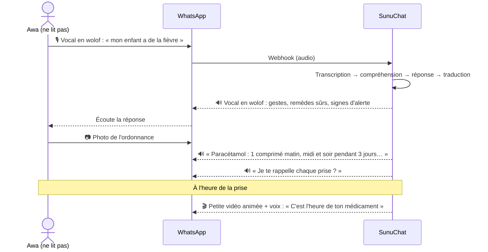
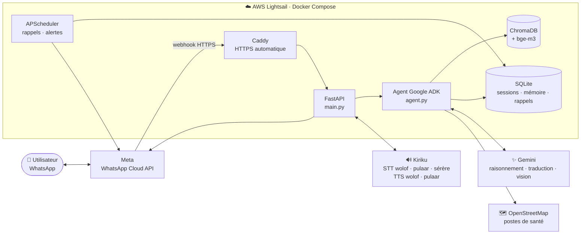
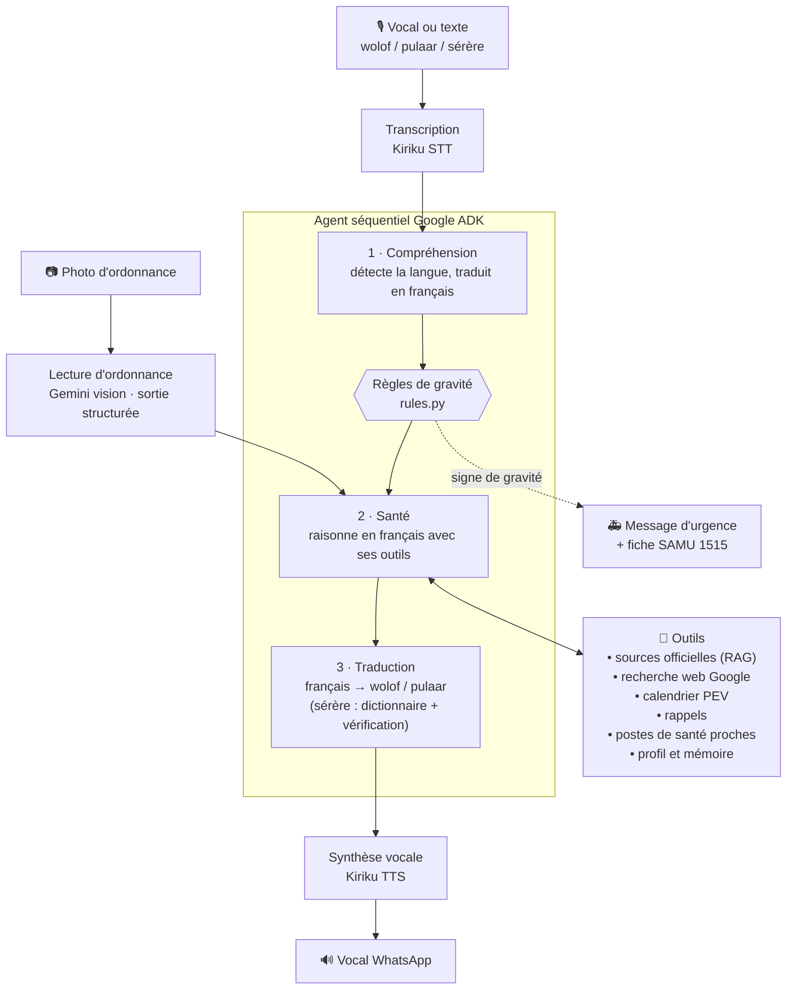
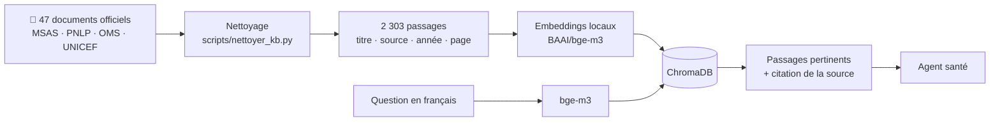
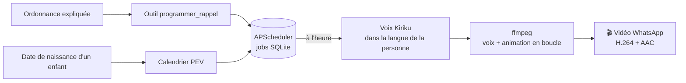
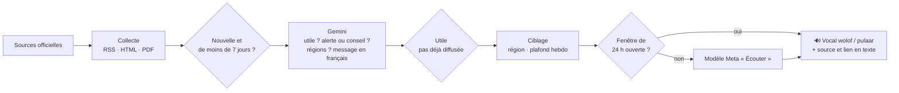
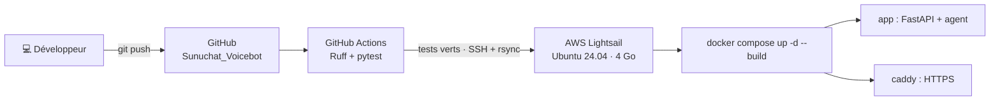

<div align="center">

# 🩺 SunuChat

**L'assistant santé vocal sur WhatsApp, en wolof, en pulaar et en sérère, pour celles et ceux qui ne savent pas lire.**

*On parle, il écoute. Il répond en vocal, dans notre langue.*


<br/>

<a href="https://wa.me/221769329923"></a>

<a href="https://wa.me/221769329923"></a>

*Scanne le QR code ou clique sur le bouton, puis envoie un vocal en wolof, en pulaar ou en sérère.*

</div>

---

## Sommaire

1. [Le problème](#-le-problème)
2. [Notre solution](#-notre-solution)
3. [Fonctionnalités](#-fonctionnalités)
4. [Démo : ce que vit l'utilisateur](#-démo--ce-que-vit-lutilisateur)
5. [Architecture](#-architecture)
6. [Stack technique](#-stack-technique)
7. [Fiabilité et sécurité](#-fiabilité-et-sécurité)
8. [Installation](#-installation)
9. [Déploiement](#-déploiement)
10. [Structure du code](#-structure-du-code)
11. [Impact et suite du projet](#-impact-et-suite-du-projet)

---

## 🎯 Le problème

Au Sénégal, une grande partie des adultes ne lit pas le français, et beaucoup ne lisent aucune
langue. Pourtant, presque toute l'information de santé est **écrite, et en français** : affiches de
prévention, notices, ordonnances, carnets de vaccination.

Conséquences concrètes :

- une ordonnance mal comprise, et le traitement est mal pris ;
- un rendez-vous de vaccin oublié, et l'enfant n'est pas protégé ;
- un signe de gravité (paludisme grave, déshydratation) qui n'est pas reconnu à temps ;
- un poste de santé qu'on ne sait pas trouver.

Mais presque tout le monde a **WhatsApp** et envoie des **messages vocaux** tous les jours.

## 💡 Notre solution

**SunuChat** est un numéro WhatsApp à qui l'on parle comme à un agent de santé communautaire :

> 🎙️ *« Sama doom am na yaram bu tàng ci guddi gi, lan laa wara def ? »*
> 🔊 Réponse vocale en wolof : ce qu'il faut faire tout de suite, les remèdes sûrs à la maison,
> les signes qui doivent faire partir au poste de santé.

- **100 % vocal** : aucune lecture nécessaire, ni menu ni bouton à lire.
- **Wolof et pulaar** (Fuuta) : la langue est reconnue automatiquement.
- **Sérère** : on dit « seereer » pour passer en sérère. Gemini ne parlant pas cette langue, le
  bot s'appuie sur un dictionnaire de santé (Crétois) et ne dit en sérère que ce qu'il peut dire
  sans inventer ; sinon, il répond en wolof.
- **Fiable** : les réponses s'appuient d'abord sur les documents officiels (Ministère de la
  Santé, PNLP, OMS, UNICEF), puis sur une recherche web pour les autres sujets.
- **Utile pour de vrai** : le bot aide au maximum (gestes, remèdes sûrs, médicaments sans
  ordonnance) et n'oriente vers le médecin que lorsque c'est nécessaire.

## ✨ Fonctionnalités

| | Fonctionnalité | Description |
|---|---|---|
| 🎙️ | **Conversation vocale** | Vocal en entrée, vocal en sortie, en wolof, en pulaar ou en sérère. |
| 📖 | **Sérère par dictionnaire** | 469 mots de santé tirés du dictionnaire de Crétois ; chaque réponse sérère est vérifiée mot à mot puis retraduite avant de partir (voir [assets/serer](assets/serer/README.md)). |
| 📚 | **RAG sur sources officielles** | 47 documents officiels, 2 303 passages indexés : paludisme, dengue, vaccination (PEV), nutrition… |
| 🌍 | **Toutes les maladies** | Recherche Google intégrée pour le reste : cancer, diabète, hypertension, Octobre rose, épidémies en cours. |
| 📄 | **Lecture d'ordonnance** | Photo ou PDF d'une ordonnance → médicaments, doses, prises et durée expliqués en vocal. |
| ⏰ | **Rappels de médicaments** | Rappel vocal à l'heure de chaque prise, sur une petite animation vidéo. |
| 💉 | **Rappels de vaccins** | Calendrier PEV calculé à partir de la date de naissance ; rappel la veille de chaque rendez-vous. |
| 🚑 | **Détection d'urgence** | Règles fixes sur les signes de gravité → message d'urgence + fiche contact **SAMU 1515** en un appui. |
| 📍 | **Poste de santé le plus proche** | À partir de la position WhatsApp ou du nom du quartier (OpenStreetMap). |
| 🌧️ | **Alertes d'hivernage** | Campagnes de prévention paludisme / dengue envoyées aux inscrits. |
| 📢 | **Veille sanitaire proactive** | Le bot lit des sources fiables (Ministère de la Santé, ANACIM, OMS, APS, Le Soleil) et envoie de lui-même, en vocal, alertes (épidémie, canicule…) et conseils (dépistage gratuit, vaccination, prévention…) aux personnes concernées. Source toujours citée, invitation à vérifier. |
| 🧠 | **Mémoire** | Se souvient de la langue, de la localité et des enfants d'une conversation à l'autre. |

## 🎬 Démo : ce que vit l'utilisateur



## 🏗️ Architecture

### Vue d'ensemble



### Le pipeline de l'agent

Le cœur de SunuChat est un **agent séquentiel en trois étapes** (Google ADK), avec le
**français comme langue pivot** : les documents officiels et les modèles sont les plus fiables en
français, et la traduction finale est confiée au meilleur modèle disponible.



| Étape | Rôle | Modèle conseillé |
|---|---|---|
| **Compréhension** | Langue, traduction vers le français, intention | `gemini-flash-lite-latest` (rapide) |
| **Santé** | Raisonnement médical, appels d'outils, réponse en français | `gemini-3.8-flash` |
| **Traduction** | Texte final lu par la voix, en wolof ou en pulaar | `gemini-3.1-pro-preview` (qualité maximale) |
| **Ordonnance** | Lecture d'écriture manuscrite, sortie JSON | même modèle que la traduction |

### Le RAG : des réponses ancrées dans les sources officielles



Les embeddings tournent **en local** (aucun quota, aucune donnée envoyée à un tiers) avec
`bge-m3`, un modèle multilingue performant en français.

### Rappels vocaux animés



## 🧰 Stack technique

| Couche | Technologies |
|---|---|
| **Canal** | WhatsApp Cloud API (Meta) : vocaux, vidéos, fiches contact, positions |
| **Backend** | Python 3.12, FastAPI, Uvicorn, httpx, Pydantic Settings |
| **IA et agents** | Google ADK (agent séquentiel, outils, mémoire, compression du contexte), Google Gemini (texte, vision, recherche Google intégrée) |
| **Voix** | API Kiriku : reconnaissance vocale en wolof, pulaar et sérère ; synthèse en wolof et en pulaar (le sérère est lu par la voix pulaar) |
| **RAG** | ChromaDB, sentence-transformers, `BAAI/bge-m3`, pypdf, BeautifulSoup |
| **Données** | SQLite (sessions ADK, mémoire longue, rappels), SQLAlchemy |
| **Planification** | APScheduler (rappels de médicaments, vaccins, campagnes) |
| **Médias** | ffmpeg (imageio-ffmpeg) : conversion audio OGG/Opus, vidéos de rappel |
| **Géolocalisation** | OpenStreetMap (Nominatim + Overpass), sans clé |
| **Infra** | Docker, Docker Compose, Caddy (HTTPS Let's Encrypt), AWS Lightsail (Paris) |
| **Qualité** | pytest (55 tests), Ruff, GitHub Actions |
| **Outils** | uv (dépendances et environnement Python) |

## 🛡️ Fiabilité et sécurité

**Sécurité médicale**
- Les signes de gravité sont détectés par des **règles fixes** (`rules.py`), pas seulement par le
  modèle : le message d'urgence et la fiche SAMU partent toujours.
- Le bot ne pose jamais de diagnostic certain, ne propose jamais d'antibiotique sans ordonnance
  et ne modifie jamais une dose prescrite.
- Les réponses citent d'abord les documents officiels.

**Résilience**
- **Bascule automatique entre modèles** : si un modèle Gemini est saturé ou à court de quota
  (erreurs 429 / 503), le suivant de `FALLBACK_MODELS` prend le relais, sans que l'utilisateur
  ne s'en rende compte.
- Si la recherche web est indisponible, l'agent répond quand même avec ses sources.
- En cas d'échec, l'utilisateur reçoit toujours un **vocal d'excuse clair**, jamais le silence.

**Données personnelles**
- Signature Meta vérifiée sur chaque webhook.
- Secrets uniquement dans `.env`, jamais dans le code.
- Embeddings calculés en local.
- Désinscription des alertes en disant simplement « stop ».
- Page de confidentialité servie sur `/confidentialite`.

## ⚙️ Installation

**Prérequis** : Python 3.12, [uv](https://docs.astral.sh/uv/), une clé Gemini, un numéro
WhatsApp Business (Meta), un accès à l'API Kiriku.

```bash
git clone https://github.com/Alioukun221/Sunuchat_Voicebot.git
cd Sunuchat_Voicebot
uv sync                       # Python 3.12 + dépendances
cp .env.example .env          # puis remplir les clés
uv run python -m sunuchat.knowledge build   # construit l'index RAG
uv run sunuchat               # serveur sur http://localhost:8000
ngrok http 8000               # URL publique pour le webhook Meta
```

Dans Meta (developers.facebook.com → ton app → WhatsApp → Configuration) : URL de rappel
`https://<url>/webhook`, jeton de vérification = `WHATSAPP_VERIFY_TOKEN`, puis abonner le champ
**messages**.

<details>
<summary><b>Variables d'environnement principales</b></summary>

| Variable | Rôle |
|---|---|
| `GOOGLE_API_KEY` | Clé Gemini |
| `AGENT_MODEL` | Modèle de l'étape santé |
| `FAST_MODEL` | Modèle de l'étape compréhension |
| `TRANSLATION_MODEL` | Modèle de traduction et de lecture d'ordonnance |
| `FALLBACK_MODELS` | Modèles de secours, dans l'ordre |
| `WHATSAPP_ACCESS_TOKEN`, `WHATSAPP_PHONE_NUMBER_ID`, `WHATSAPP_VERIFY_TOKEN`, `WHATSAPP_APP_SECRET` | Accès WhatsApp Cloud API |
| `SPEECH_API_BASE_URL`, `SPEECH_API_KEY` | Accès à l'API vocale Kiriku |
| `EMBEDDING_MODEL` | Modèle d'embeddings (`BAAI/bge-m3`) |
| `TEMPLATE_RAPPEL_VACCIN`, `TEMPLATE_ALERTE_SAISON` | Modèles de messages Meta (hors fenêtre de 24 h) |

La liste complète est dans [`.env.example`](.env.example).
</details>

<details>
<summary><b>Commandes du RAG</b></summary>

```bash
uv run python -m sunuchat.knowledge list                # documents du corpus
uv run python -m sunuchat.knowledge build --limit 300   # petit index pour tester vite
uv run python -m sunuchat.knowledge build --reset       # tout réindexer
uv run python -m sunuchat.knowledge search "comment entretenir la moustiquaire"
```

Le corpus nettoyé est dans `data/kb/` : `chunks.jsonl` (passages), `textes/` (un texte par
document) et `manifest.csv` (catalogue). Pour le régénérer depuis les PDF bruts :
`python3 scripts/nettoyer_kb.py ~/Downloads/kb data/kb` (nécessite `pdftotext`).
</details>

<details>
<summary><b>Modèles de messages Meta (rappels hors des 24 h)</b></summary>

Hors des 24 h qui suivent le dernier message d'une personne, WhatsApp n'accepte que des modèles
approuvés, sans vocal. Le rappel de vaccin passe alors par un modèle texte + image :

- `TEMPLATE_RAPPEL_VACCIN=rappel_vaccin` (Utilité) : « 💉 Rappel SunuChat : demain {{2}}, ton
  enfant a rendez-vous pour ses vaccins de {{1}} ({{3}}). Va au poste de santé avec son carnet. »
- `TEMPLATE_ALERTE_SAISON=alerte_hivernage` (Marketing) : « 🦟 C'est l'hivernage : le paludisme
  et la dengue reviennent… Écris stop pour ne plus recevoir d'alertes. »

Images d'en-tête à déposer dans `assets/images/` (`vaccins`, `hivernage`, carré 1080 × 1080).
</details>

## 📢 Veille sanitaire proactive

SunuChat n'attend pas qu'on lui écrive. Toutes les 6 h (`VEILLE_INTERVALLE_MIN=360`), il lit :

| Source | Contenu |
|---|---|
| Ministère de la Santé | Flux RSS des actualités, communiqués et leurs PDF (points de situation) |
| ANACIM | Flux RSS, filtré sur les alertes (chaleur, fortes pluies, poussière…) |
| OMS | Disease Outbreak News : le Sénégal et ses voisins |
| APS | Rubrique santé de l'Agence de presse sénégalaise (agence officielle) |
| Le Soleil | Rubrique santé du quotidien national |

Gemini classe chaque publication : **alerte** (un danger à éviter : épidémie, canicule,
médicament contrefait…), **conseil** (une information utile : dépistage gratuit, campagne de
vaccination, Octobre rose, prévention…) ou sans intérêt (vie de l'administration, politique).



- **Source toujours citée, vérification toujours demandée** : ces phrases sont ajoutées par le
  code (`textes.ALERTE_VERIFIER`), pas par le modèle. Le lien de la publication suit en texte.
- **Garde-fous** : sources officielles et presse de référence uniquement ; premier passage
  muet (rien de l'historique n'est envoyé) ; **une seule publication par passage** (la plus
  grave d'abord, les autres attendent) ; avant chaque envoi, Gemini la compare à ce qui est
  déjà parti : la même information venue d'une autre source ou reformulée est écartée ;
  3 alertes par semaine au plus
  (`VEILLE_MAX_PAR_SEMAINE`, la gravité 3 passe toujours) ; alerte régionale envoyée seulement
  aux habitants de la région (déduite de la localité).
- **Hors des 24 h** : modèle Meta `TEMPLATE_ALERTE_SANTE` (« 📢 Alerte santé : {{1}}. Source :
  {{2}}. Appuie sur Écouter… », bouton de réponse rapide « Écouter »). L'alerte part en vocal
  quand la personne appuie, ou dès qu'elle écrit au bot.
- **L'agent connaît les alertes en cours** : « qu'est-ce qui se passe en ce moment ? » trouve
  une réponse sourcée.

```bash
uv run python -m sunuchat.veille --dry-run --tout --jours 60   # analyser sans rien envoyer
uv run python -m sunuchat.veille --a 22177xxxxxxx --tout       # essai sur son numéro
```

**Essai en production** : `VEILLE_TEST_NUMEROS=22177xxxxxxx` et `VEILLE_INTERVALLE_MIN=5` dans le
`.env`. Seuls ces numéros reçoivent, sans plafond, dès le premier passage. Pour ouvrir à tous :
vider `VEILLE_TEST_NUMEROS` et remettre `VEILLE_INTERVALLE_MIN=360`.

## 🚀 Déploiement



- **Serveur** : AWS Lightsail (région Paris), Ubuntu 24.04, 4 Go de RAM, IP fixe.
- **HTTPS** : Caddy obtient le certificat Let's Encrypt tout seul (domaine `sslip.io`).
- **Persistance** : `data/` (bases, index) et le cache du modèle `bge-m3` sont des volumes Docker,
  conservés entre les mises à jour.
- **CI/CD** : à chaque push sur `master`, GitHub Actions lance les tests puis met le serveur à jour.

Mise à jour manuelle :

```bash
rsync -avz --exclude .venv --exclude .git --exclude __pycache__ --exclude .env \
  -e "ssh -i ~/.ssh/<cle>.pem" ./ ubuntu@<ip>:~/sunuchat/
ssh -i ~/.ssh/<cle>.pem ubuntu@<ip> "cd ~/sunuchat && docker compose up -d --build"
```


## 📁 Structure du code

```
src/sunuchat/
├── main.py         Serveur FastAPI : webhook WhatsApp, /health, /confidentialite
├── agent.py        Agent Google ADK (compréhension → santé → traduction), outils, bascule de modèles
├── rules.py        Règles fixes : signes de gravité, calendrier vaccinal PEV
├── knowledge.py    RAG : nettoyage, indexation ChromaDB, recherche
├── ordonnance.py   Lecture d'ordonnance (Gemini vision, sortie structurée)
├── speech.py       Voix Kiriku (STT / TTS), conversion audio, vidéo de rappel
├── whatsapp.py     Envoi de vocaux, vidéos, fiches contact ; téléchargement des médias
├── reminders.py    Rappels vocaux de médicaments et de vaccins
├── campaigns.py    Inscriptions, alertes d'hivernage, fenêtre de 24 h
├── veille.py       Veille sanitaire : collecte, analyse Gemini, alertes ciblées
├── places.py       Postes de santé proches (OpenStreetMap)
├── memory.py       Sessions et mémoire longue par numéro
├── onboarding.py   Messages fixes en vocal, commandes « stop » / « alerte », fiche SAMU
├── serer.py        Sérère : dictionnaire de Crétois, vérification des réponses, voix
├── textes.py       Textes fixes en wolof et en pulaar
├── images.py       Visuels envoyés une fois à Meta puis réutilisés
└── config.py       Configuration (.env)
assets/animations/  Animations des rappels (médicament, vaccin)
assets/serer/       Dictionnaire sérère (lexique de Crétois, phrases attestées et à traduire)
data/kb/            Corpus officiel nettoyé
deploy/             Caddyfile, script d'installation du serveur
tests/              55 tests (pytest)
```

Tests et lint :

```bash
uv run pytest
uv run ruff check src tests
```

## 🌱 Impact et suite du projet

**Pour qui ?** Les mères et les familles en zone rurale et périurbaine, les personnes âgées, et
toute personne qui ne lit pas le français. Les agents de santé communautaires (*bajenu gox*,
relais) peuvent aussi s'en servir comme appui.

**Pourquoi ça peut passer à l'échelle ?**
- Aucun téléchargement : WhatsApp est déjà sur les téléphones.
- Aucune lecture : tout est vocal.
- Coût par conversation faible, infrastructure légère (un seul serveur).

**Prochaines étapes**
- Faire valider les textes et les réponses par des locuteurs natifs et des professionnels de santé.
- Rappels vocaux hors de la fenêtre de 24 h grâce à des modèles Meta avec en-tête vidéo.
- Tableau de bord anonymisé pour le suivi épidémiologique (questions fréquentes par zone).
- Partenariats avec les districts sanitaires et les programmes nationaux (PNLP, PEV).

---

<div align="center">

**SunuChat** · *Sunu* = « notre » en wolof : notre assistant santé, dans notre langue.

⚠️ SunuChat donne des informations de santé générales et ne remplace pas une consultation
médicale. En cas d'urgence, appelez le **SAMU au 1515**.

</div>
